<p align="center">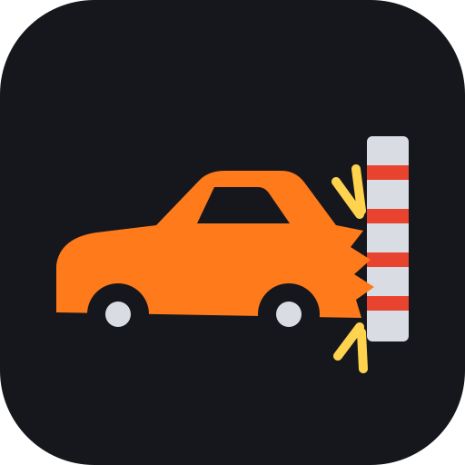</p>

<h1 align="center">Crush Stream</h1>

<p align="center"><b>Play: <a href="https://baconwhiskey.org/crush/">https://baconwhiskey.org/crush/</a></b></p>

Crush Stream is a car-crash game that runs in the browser. Every car is a soft body: named control particles are
shape-matched (Müller et al. 2005) inside crush cages, so a head-on folds the bonnet, a T-bone dents the door and a press
flattens the roof. Pile up to 32 cars in slow motion, win a demolition derby, race a circuit with traffic and police, last
as long as you can against a growing pack of cops, throw cars at a stack in the Lab, or take friends into a room over WebRTC
with proximity voice. It is TypeScript on three.js with a React HUD, Rapier for the ragdolls and a Rust/WASM skin kernel, and
it needs a WebGL2 browser and nothing else. All pictures here are the `ultra` FX tier.

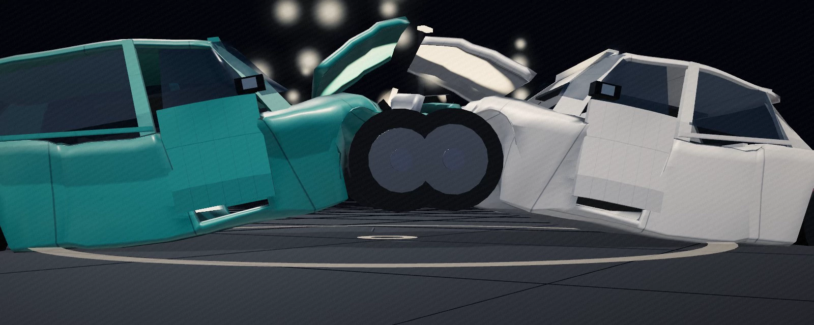

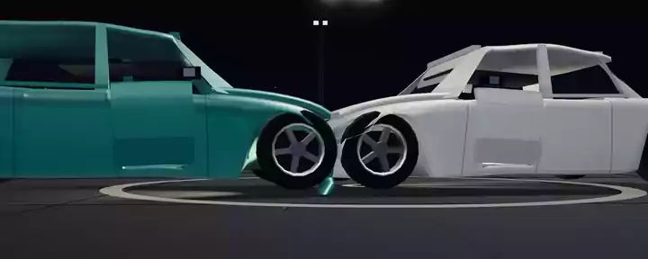

## What is in it

Each row links the document that covers the system; [`docs/ARCHITECTURE.md`](docs/ARCHITECTURE.md) is the map of all of them.

### The crash model

| System | What it does | Docs |
|---|---|---|
| Soft-body skin | Shape-match clusters, eight-corner crush cages per body part and contact sensors; plastic travel builds up over hits. | [`ARCHITECTURE`](docs/ARCHITECTURE.md), [`CRUSH_CALIBRATION`](docs/CRUSH_CALIBRATION.md), [`.extraResearch`](.extraResearch/README.md) |
| WASM skin kernel | The skin and normals loops run in a 2.7 kB Rust module, 1.5 to 1.9 times faster than the JS loop and bit-identical. The built module is committed. | [`DEPLOY`](docs/DEPLOY.md#the-skin-kernel-rust---wasm) |
| Unified contact | One contact model for car against car, prop, wall, ground and the rigs; the rigs are held to the same bars as a car-car hit. | [`UNIFIED_CONTACT`](docs/UNIFIED_CONTACT.md), [`CONTACT_PARITY`](docs/CONTACT_PARITY.md) |
| Parts, glass, panels | Doors hinge, latch and tear off, mirrors break away, glass cracks and bursts, panels stretch and flap, wheels come loose. | [`PANEL_FLAP`](docs/PANEL_FLAP.md), [`DOOR_RIG`](docs/DOOR_RIG.md) |
| Load crush | A roof or a face crushes under the weight stacked on it; the Stack scene drops cars onto a column. | [`LOAD_CRUSH`](docs/LOAD_CRUSH.md) |
| Wreck sleep | A wreck that has lain still for about a second goes to sleep; a replay restores each wreck's rest timer, so it starts the clip asleep, or partway to sleep, exactly as it was live. | [`HIGHLIGHTS`](docs/HIGHLIGHTS.md) |
| Ragdolls | Drivers are thrown through the windscreen on big hits; purses, loose props and cones tumble in a Rapier world that meets the same solids a car does. | [`CINEMATIC`](docs/CINEMATIC.md) |

### Driving and cameras

| System | What it does | Docs |
|---|---|---|
| Classes and handling | Five classes (sedan, muscle, truck, monster, police), gears and one Realism slider from arcade to realistic. Damage changes how a car drives. | [`HANDLING`](docs/HANDLING.md) |
| Controls | Keyboard, controller and touch work together; phones get a thumb pad and captioned buttons. | [`CONTROLS`](docs/CONTROLS.md) |
| Cameras | Chase, far chase and hood views, spectator cams including Auto, a crash cam in slow motion, impact shake, mouse look. | [`CONTROLS`](docs/CONTROLS.md), [`CINEMATIC`](docs/CINEMATIC.md) |
| Garage | Pick the car and spray-paint it, and choose the driver's look. The picks travel in the share URL. | [`CONTROLS`](docs/CONTROLS.md#shareable-url) |

### Scenes and modes

| Scene | What it does | Docs |
|---|---|---|
| Fleet | The sandbox: up to 32 cars at a spawn speed you set, with a jersey barrier, ramp balls and jump ramps. | [`CONTROLS`](docs/CONTROLS.md) |
| Derby | Demolition derby with AI drivers that pick targets, ram, reverse out and keep a hit clock; the score board ranks them. | [`DERBY_AI`](docs/DERBY_AI.md) |
| Race | Nine courses and a campaign, 2 to 16 racers from the setup menu, NPC traffic, designed shortcuts, respawn or no-reset, AI difficulty (easy, medium, hard) and aggression, drafting. | [`RACE_DESIGN`](docs/RACE_DESIGN.md) |
| Time of day | Daytime, Sunset or Nighttime behind a race: a panoramic sky for each, the sun's height and the lamps follow. Drawn only, never in the sim, a replay or the wire; share links carry it. | [`RACE_DESIGN`](docs/RACE_DESIGN.md) |
| Police chase | A race option: cops stake out, pursue and bust a car held slow within 20 m. | [`RACE_DESIGN`](docs/RACE_DESIGN.md) |
| Survival | Driver 2's mode on Havana's Plaza de la Revolución or the National Mall (the bottom bar's Survival opens its own course menu; a `#scene=survival&track=…` link starts the run): a pack of cops that grows, the stopwatch is the score; co-op in a room. | [`SURVIVAL`](docs/SURVIVAL.md) |
| Press | Two plates close on a car. | [`CONTACT_PARITY`](docs/CONTACT_PARITY.md) |
| Pistons | Eight horizontal rams around a car, fired one at a time or all together. | [`PISTON_RIG`](docs/PISTON_RIG.md) |
| Doors | A rig that rams an open or shut door and mirror from the side. | [`DOOR_RIG`](docs/DOOR_RIG.md) |
| Corkscrew | A ramp that launches a car into a spin. | [`CONTROLS`](docs/CONTROLS.md) |
| Stack | Cars dropped onto a column, crushed from the top. | [`LOAD_CRUSH`](docs/LOAD_CRUSH.md) |
| Range | FlatOut's driver-flinging event: a car hits a jersey barrier at 100 km/h and its driver flies into a sand field marked every 10 m. | [`CINEMATIC`](docs/CINEMATIC.md) |
| Lab | A workbench where you flick a toy car at a house of cards made of cars and a wall of props. | [`PERF_BENCH`](docs/PERF_BENCH.md) |
| Multiplayer | Host or join a room by code, or press Play online for the best open public race. Host-authoritative over WebRTC data channels, up to 8 players; a lobby on Havana; proximity voice. | [`MULTIPLAYER`](docs/MULTIPLAYER.md) |

### Replays, look and sound

| System | What it does | Docs |
|---|---|---|
| Crash highlights | A race's five biggest crashes replay in slow motion behind the results, the same on every peer. Watch one alone, Save it in the browser, or flag it. | [`HIGHLIGHTS`](docs/HIGHLIGHTS.md) |
| FX tiers | `off`, `minimal`, `low`, `high`, `ultra` and Auto, which steps down when the frame is full and never lifts to Ultra. Bloom, grade, tyre marks and smoke, hit-stop, night and wet asphalt, the cel-shaded scene change. | [`CINEMATIC`](docs/CINEMATIC.md), [`PERF_HITCH`](docs/PERF_HITCH.md) |
| Ultra | A lazy 3.4 MB look: an HDRI sky, a 2048 px sun shadow and PBR asphalt, concrete and ground. `?fx=ultra` picks it. | [`CINEMATIC`](docs/CINEMATIC.md) |
| Audio | Engine voices from a worklet, tuned per class and damage; a four-track playlist with a credits dialog; levels in the Audio section. | [`CONTROLS`](docs/CONTROLS.md), [`DEPLOY`](docs/DEPLOY.md#music-served-from-a-folder-on-the-box-not-from-git) |
| Share URL | The page's `#` records scene, settings and seed; copy it and anyone gets the same field. Changed settings carry a dot and a reset chip. | [`CONTROLS`](docs/CONTROLS.md#shareable-url) |
| Benchmarks | `?bench=city`, `?bench=strip` and `?bench=lab` run a timed loop and submit a card; the page offers an update when a new build is live. | [`PERF_BENCH`](docs/PERF_BENCH.md), [`DEPLOY`](docs/DEPLOY.md) |

## Pictures

Every picture is the `ultra` tier; [`scripts/readme-shots.mjs`](scripts/readme-shots.mjs) makes them.

| | |
|---|---|
| **Derby** ([`DERBY_AI`](docs/DERBY_AI.md)) | **Race: Harbour Streets** ([`RACE_DESIGN`](docs/RACE_DESIGN.md)) |
| 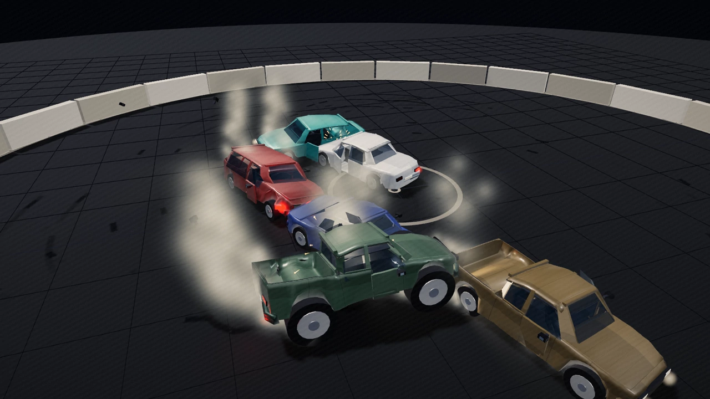 | 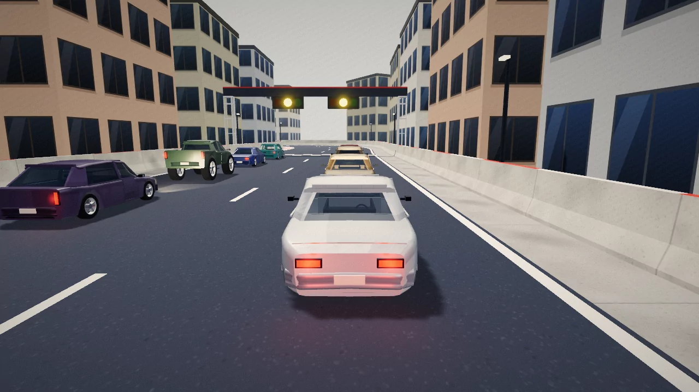 |
| **Race: Crossover Canyon** | **Survival** ([`SURVIVAL`](docs/SURVIVAL.md)) |
|  |  |
| **Press** | **Pistons** ([`PISTON_RIG`](docs/PISTON_RIG.md)) |
| 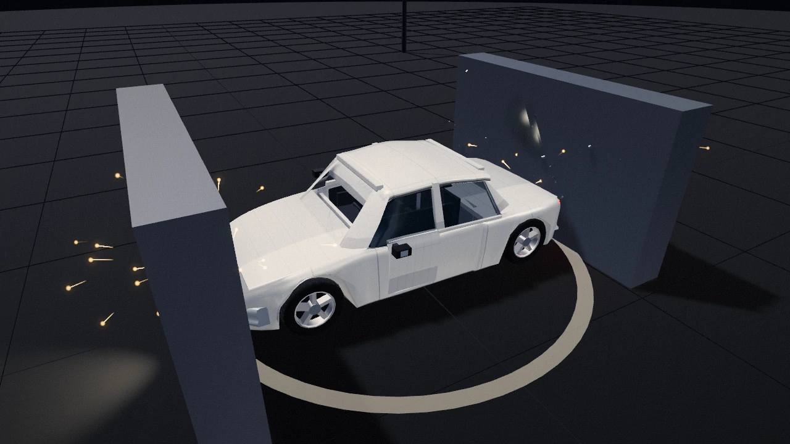 | 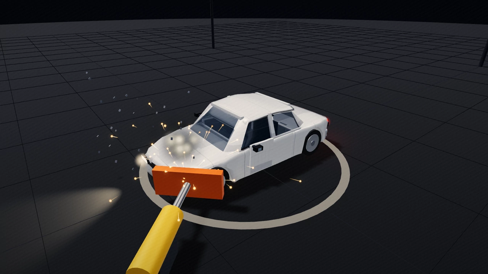 |
| **Doors** ([`DOOR_RIG`](docs/DOOR_RIG.md)) | **Corkscrew** |
| 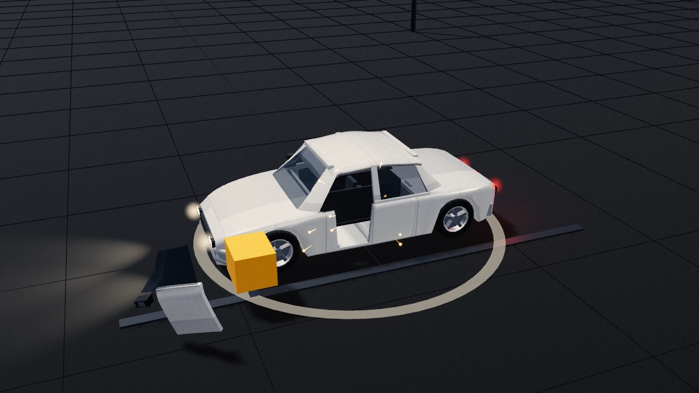 |  |
| **Control particles (P)** | **Deformation rig (G)** |
| 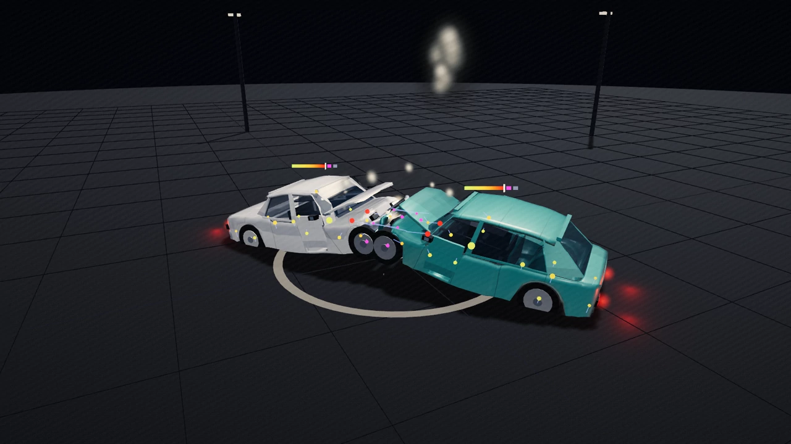 | 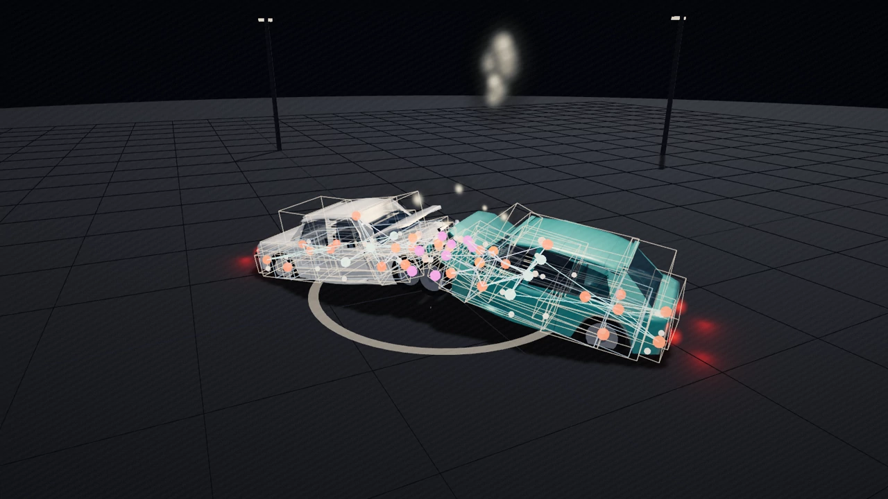 |

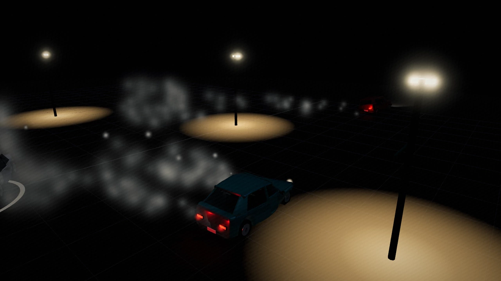


## Controls

Every key, controller button and touch control is in [`docs/CONTROLS.md`](docs/CONTROLS.md). The basics:

| Action | Keyboard | Controller |
|---|---|---|
| Gas / brake, then reverse | W / S | RT / LT |
| Steer | A / D | left stick |
| Handbrake / boost | Space / Shift | A / X (Cross / Square) |
| Recover, respawn in a race | R | D-pad ↓ |
| Camera view | V | Y / Triangle |
| Pause / full menu | Esc / H | Start |
| FX tier / night / wet | F / H / X | |

Scenes from the bottom bar or a key (none of them a driving key): derby `=`, Survival `-`, race Z, press `[`, pistons I, doors N,
corkscrew `,`, stack `/`; the same key again goes back to the fleet. Range, Lab and Garage are on the bar.

## Quick start

Node 22.6 or newer on Linux, WSL2 or macOS; the browser needs WebGL2. Packages come from pnpm through corepack.

```bash
git clone https://github.com/aphix/crash-deformer-test.git
cd crash-deformer-test
corepack pnpm install --frozen-lockfile
npm run dev          # Vite + HMR on http://localhost:8080 (binds 0.0.0.0)
```

On WSL2, open `http://localhost:8080/` in the Windows browser. Start Vite through the npm scripts, not `vite` directly: they
run it through `scripts/with-app-env.mjs`. `npm run build` then `npm run preview:restart` serves the built output on
`127.0.0.1:8081`; `npm run preview:stop` stops it.

## Checks

| Command | What it does |
|---|---|
| `npm run test:app` | the `src/game`, `src/lib/multiplayer`, `src/lib/submissions` and `src/lib/deploy` suites plus `scripts/with-app-env.test.mjs` (`node --test`); **the gate** |
| `npm test` | `src/game`, `src/lib/submissions`, `src/lib/deploy`, the multiplayer rate-limit test and every `scripts/**/*.test.mjs` |
| `npm run test:ai-long-run` | the full-sanity suite (`src/game/**/*.ai-long-run.ts`): long AI-driven runs that watch whole fields for stuck cars and false ejections; not part of the gate |
| `npm run typecheck` | `tsc --noEmit` |
| `npm run check:boundaries` | the structural rules of [`docs/ARCHITECTURE.md`](docs/ARCHITECTURE.md), ratcheted against `scripts/boundary-caps.json` |
| `npm run check:programs` | plays every scene, FX tier and course in headless Chromium against a running server and fails if a GPU program links mid-play ([`docs/PERF_HITCH.md`](docs/PERF_HITCH.md)) |
| `npm run lint` | `oxlint` ([`docs/TOOLCHAIN.md`](docs/TOOLCHAIN.md)) |
| `node scripts/check-links.mjs` | every relative link in this file and `docs/*.md` resolves |
| `npm run bench`, `npm run sweep` | JS kernel timings; the squash × buckle crash sweep ([`docs/CRUSH_CALIBRATION.md`](docs/CRUSH_CALIBRATION.md)) |
| `node scripts/bench-browser.mjs` | real-browser frame bench ([`docs/PERF_BENCH.md`](docs/PERF_BENCH.md)) |
| `npm run build:kernel`, `npm run build:motor`, `npm run bake:env` | rebuild the WASM skin kernel, the engine-sound worklet and the baked environment map |

[`AGENTS.md`](AGENTS.md) has the contributor rules these checks serve.

## Build and deploy

`npm run build:node && npm run start:node` builds and runs a self-contained node server in `.output/` (`PORT`, `HOST`,
`PGLITE_DATA_DIR`, `APP_BASE`). The live site is a node build under `APP_BASE=/crush/` behind nginx, deployed by pull with a
systemd timer, health-checked and rolled back on failure: [`docs/DEPLOY.md`](docs/DEPLOY.md). The install steps for the
systemd and nginx kit are in [`deploy/README.md`](deploy/README.md). `<base>version.json` reports the build's commit.

To remake the pictures above: build, serve the build, and run `node scripts/readme-shots.mjs <port>`.

## Architecture

[`docs/ARCHITECTURE.md`](docs/ARCHITECTURE.md) is the place to start: thirteen bounded contexts in twelve layers (kernel,
world, deform, vehicle, contact, scenes, ai, match, present and net, hud, engine, ui), the frame loop and the rules
`npm run check:boundaries` enforces. Every other document covers one system and is linked from the tables above.

- [`docs/CODING_STANDARDS.md`](docs/CODING_STANDARDS.md): the binding code rules.
- [`docs/DESIGN_PILLARS.md`](docs/DESIGN_PILLARS.md): arcade fun first, performance is crucial, no hitching.
- [`docs/TOOLCHAIN.md`](docs/TOOLCHAIN.md): the lint, test and build tooling and what each costs.
- A change that alters what a replay computes bumps `REPLAY_VERSION` in `src/game/net/reel-codec.ts`
  ([`docs/HIGHLIGHTS.md`](docs/HIGHLIGHTS.md)).

The papers behind the solver, each with an analysis note and the cross-paper findings, are in
[`.extraResearch/`](.extraResearch/README.md).

## Credits

- Music: four NoCopyrightSounds releases (Aspyer, Luke Alexander, Syntact, MANSHN), credited in the game's Credits dialog (`?`
  in the key list) from `public/music/manifest.json`. The mp3s are not in this repository.
- Engine sound: the [engine-sound-generator](https://github.com/Antonio-R1/EngineSoundGenerator) worklet, MIT
  ([`kernels/motor/LICENSE`](kernels/motor/LICENSE)).
- Ultra textures and sky: [Poly Haven](https://polyhaven.com/license), CC0; the four sets are named in `src/game/present/ultra/ultra.ts`.
- Ragdolls: the approach of [rapierjs-ragdoll](https://github.com/mattvb91/rapierjs-ragdoll), MIT, rewritten for this engine.
